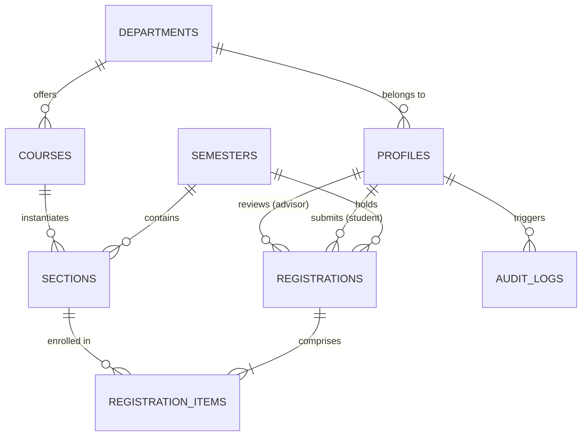

# DATABASE SCHEMA — DIU Course Registration Platform

> **Engine**: PostgreSQL 15+ (Hosted on Supabase)  
> **Schema Migration**: `supabase/migrations/20261118000000_phase0_init.sql`  
> **Security Model**: Row Level Security (RLS) Enabled on all tables  

---

## 1. Entity-Relationship Overview



---

## 2. Custom Enumerations

### 2.1 `user_role`
Institutional permissions classification:
- `'student'`: Enrolled undergraduate or graduate scholar.
- `'advisor'`: Faculty member assigned to advise cohorts.
- `'department_head'`: Department chairperson / academic coordinator.
- `'admin'`: Registrar officer / system administrator.

### 2.2 `registration_status`
Lifecycle states of an advising semester application:
- `'draft'`: Student is currently modifying courses in advising cart.
- `'pending_advisor'`: Submitted by student; awaiting academic advisor review.
- `'approved'`: Authorized by advisor; enrolled in official sections.
- `'rejected'`: Returned to student for scheduling revisions or prerequisite deficiency.
- `'dropped'`: Officially cancelled by student or administration.

### 2.3 `semester_season`
- `'spring'`: January – April / May cycle.
- `'summer'`: May – August / September cycle.
- `'fall'`: September – December / January cycle.

---

## 3. Table Specifications

### 3.1 `public.departments`
Academic departments within DIU faculties.
| Column | Type | Constraints | Description |
| :--- | :--- | :--- | :--- |
| `id` | UUID | PK, DEFAULT `gen_random_uuid()` | Department unique identifier |
| `code` | VARCHAR(10) | UNIQUE, NOT NULL | Program code (e.g., `'CSE'`, `'SWE'`, `'EEE'`) |
| `name` | TEXT | NOT NULL | Full department title |
| `faculty` | TEXT | NOT NULL | Parent faculty (e.g. `'Faculty of Science & IT'`) |
| `created_at` | TIMESTAMPTZ | NOT NULL, DEFAULT `now()` | Record creation timestamp |

### 3.2 `public.profiles`
Extends Supabase `auth.users` with DIU institutional academic attributes.
| Column | Type | Constraints | Description |
| :--- | :--- | :--- | :--- |
| `id` | UUID | PK, FK -> `auth.users(id)` ON DELETE CASCADE | Matches Supabase Auth user ID |
| `diu_id` | VARCHAR(30) | UNIQUE, NULLABLE | DIU Student / Faculty ID (e.g. `'211-15-12345'`) |
| `full_name` | TEXT | NOT NULL | User's legal name |
| `email` | TEXT | UNIQUE, NOT NULL | Institutional email (`@diu.edu.bd`) |
| `role` | user_role | NOT NULL, DEFAULT `'student'` | Authorization role |
| `department_code` | VARCHAR(10) | FK -> `departments(code)` ON DELETE SET NULL | Affiliated academic department |
| `cgpa` | NUMERIC(3, 2) | DEFAULT 0.00, CHECK `0.00 <= cgpa <= 4.00` | Current cumulative GPA |
| `completed_credits`| INTEGER | DEFAULT 0, CHECK `credits >= 0` | Total passed credits |
| `phone` | VARCHAR(20) | NULLABLE | Contact mobile number |
| `avatar_url` | TEXT | NULLABLE | Google profile avatar link |
| `created_at` | TIMESTAMPTZ | NOT NULL, DEFAULT `now()` | Profile creation timestamp |
| `updated_at` | TIMESTAMPTZ | NOT NULL, DEFAULT `now()` | Last modification timestamp |

### 3.3 `public.semesters`
Defines active and historical academic terms.
| Column | Type | Constraints | Description |
| :--- | :--- | :--- | :--- |
| `id` | UUID | PK, DEFAULT `gen_random_uuid()` | Term identifier |
| `year` | INTEGER | NOT NULL, CHECK `2020 <= year <= 2100` | Calendar academic year |
| `season` | semester_season | NOT NULL | Spring, Summer, or Fall term |
| `is_active` | BOOLEAN | NOT NULL, DEFAULT `false` | Whether this is the active advising term |
| `registration_starts_at` | TIMESTAMPTZ | NULLABLE | Window opening timestamp |
| `registration_ends_at` | TIMESTAMPTZ | NULLABLE | Window closing timestamp |
| `created_at` | TIMESTAMPTZ | NOT NULL, DEFAULT `now()` | Term creation timestamp |
*Constraint*: `CONSTRAINT unique_semester UNIQUE (year, season)`

### 3.4 `public.courses`
Curriculum master definitions.
| Column | Type | Constraints | Description |
| :--- | :--- | :--- | :--- |
| `id` | UUID | PK, DEFAULT `gen_random_uuid()` | Course unique identifier |
| `code` | VARCHAR(20) | UNIQUE, NOT NULL | Course code (e.g. `'CSE110'`, `'MAT101'`) |
| `title` | TEXT | NOT NULL | Official course title |
| `credits` | NUMERIC(3, 1)| NOT NULL, CHECK `credits > 0` | Academic credit value |
| `department_code`| VARCHAR(10) | FK -> `departments(code)`, NOT NULL | Offering department |
| `prerequisite_codes`| TEXT[] | NOT NULL, DEFAULT `'{}'` | Array of required prerequisite course codes |
| `syllabus_url` | TEXT | NULLABLE | Link to course syllabus / outline |
| `created_at` | TIMESTAMPTZ | NOT NULL, DEFAULT `now()` | Record creation timestamp |

### 3.5 `public.sections`
Specific class offerings scheduled for a term.
| Column | Type | Constraints | Description |
| :--- | :--- | :--- | :--- |
| `id` | UUID | PK, DEFAULT `gen_random_uuid()` | Section unique identifier |
| `course_id` | UUID | FK -> `courses(id)` ON DELETE CASCADE | Parent course reference |
| `semester_id` | UUID | FK -> `semesters(id)` ON DELETE CASCADE | Associated term |
| `section_name` | VARCHAR(10) | NOT NULL | Section identifier (e.g. `'A'`, `'60_B'`) |
| `capacity` | INTEGER | NOT NULL, DEFAULT 40, CHECK `> 0` | Maximum student capacity |
| `enrolled_count` | INTEGER | NOT NULL, DEFAULT 0, CHECK `>= 0` | Current enrolled headcount |
| `room` | VARCHAR(30) | NULLABLE | Assigned lecture room |
| `schedule` | JSONB | NOT NULL, DEFAULT `'[]'` | Time slots array `[{day, start_time, end_time, room}]` |
| `instructor_name`| TEXT | NULLABLE | Faculty instructor assigned |
| `created_at` | TIMESTAMPTZ | NOT NULL, DEFAULT `now()` | Record creation timestamp |
*Constraint*: `CONSTRAINT unique_course_section_per_semester UNIQUE (course_id, semester_id, section_name)`

### 3.6 `public.registrations`
Master registration records for a student in a specific semester.
| Column | Type | Constraints | Description |
| :--- | :--- | :--- | :--- |
| `id` | UUID | PK, DEFAULT `gen_random_uuid()` | Registration unique ID |
| `student_id` | UUID | FK -> `profiles(id)` ON DELETE CASCADE | Enrolling student |
| `semester_id` | UUID | FK -> `semesters(id)` ON DELETE CASCADE | Target academic term |
| `status` | registration_status | NOT NULL, DEFAULT `'draft'` | Current review state |
| `submitted_at` | TIMESTAMPTZ | NULLABLE | Timestamp of student submission |
| `advisor_id` | UUID | FK -> `profiles(id)` ON DELETE SET NULL | Reviewing academic advisor |
| `reviewed_at` | TIMESTAMPTZ | NULLABLE | Timestamp of advisor decision |
| `advisor_notes`| TEXT | NULLABLE | Mandatory feedback/remarks from advisor |
| `created_at` | TIMESTAMPTZ | NOT NULL, DEFAULT `now()` | Record creation timestamp |
| `updated_at` | TIMESTAMPTZ | NOT NULL, DEFAULT `now()` | Last state change timestamp |
*Constraint*: `CONSTRAINT unique_student_semester_registration UNIQUE (student_id, semester_id)`

### 3.7 `public.registration_items`
Individual course section items associated with a registration application.
| Column | Type | Constraints | Description |
| :--- | :--- | :--- | :--- |
| `id` | UUID | PK, DEFAULT `gen_random_uuid()` | Item unique ID |
| `registration_id` | UUID | FK -> `registrations(id)` ON DELETE CASCADE | Parent registration application |
| `section_id` | UUID | FK -> `sections(id)` ON DELETE RESTRICT | Selected class section |
| `status` | VARCHAR(20) | NOT NULL, DEFAULT `'enrolled'` | State: `'enrolled'`, `'waitlisted'`, `'dropped'` |
| `created_at` | TIMESTAMPTZ | NOT NULL, DEFAULT `now()` | Item creation timestamp |
*Constraint*: `CONSTRAINT unique_registration_section UNIQUE (registration_id, section_id)`

### 3.8 `public.audit_logs`
Tamper-proof event logs for compliance and accountability.
| Column | Type | Constraints | Description |
| :--- | :--- | :--- | :--- |
| `id` | UUID | PK, DEFAULT `gen_random_uuid()` | Log ID |
| `user_id` | UUID | FK -> `auth.users(id)` ON DELETE SET NULL | Actor executing operation |
| `action` | TEXT | NOT NULL | Operation verb (e.g. `'SUBMIT_REGISTRATION'`) |
| `entity_type` | TEXT | NOT NULL | Target entity (e.g. `'registration'`) |
| `entity_id` | TEXT | NULLABLE | Entity ID |
| `metadata` | JSONB | NOT NULL, DEFAULT `'{}'` | Contextual parameters & diff |
| `ip_address` | TEXT | NULLABLE | Client IP |
| `created_at` | TIMESTAMPTZ | NOT NULL, DEFAULT `now()` | Timestamp of event |

### 3.9 `public.advisor_assignments` (P0 Security Remediation)
Authoritative mapping between faculty advisors and assigned student advisees.
| Column | Type | Constraints | Description |
| :--- | :--- | :--- | :--- |
| `id` | UUID | PK, DEFAULT `gen_random_uuid()` | Assignment ID |
| `advisor_id` | UUID | FK -> `profiles(id)` ON DELETE CASCADE | Faculty advisor |
| `student_id` | UUID | FK -> `profiles(id)` ON DELETE CASCADE | Assigned student |
| `department_code` | VARCHAR(10) | FK -> `departments(code)` ON DELETE SET NULL | Academic department |
| `assigned_at` | TIMESTAMPTZ | NOT NULL, DEFAULT `now()` | Assignment timestamp |
| `is_active` | BOOLEAN | NOT NULL, DEFAULT `true` | Active status flag |
*Constraint*: `CONSTRAINT unique_active_advisor_student UNIQUE (advisor_id, student_id)`

### 3.8 `public.authorized_emails`
Admin-authorized multi-email identity registry connecting primary DIU emails and approved personal exceptions to existing student, advisor, or administrator profiles.
| Column | Type | Constraints | Description |
| :--- | :--- | :--- | :--- |
| `id` | UUID | PK, DEFAULT `gen_random_uuid()` | Unique record identifier |
| `profile_id` | UUID | FK `profiles(id)` ON DELETE CASCADE, NOT NULL | Canonical profile mapped to this email |
| `email` | VARCHAR(255) | UNIQUE, NOT NULL | Normalized lowercase Google OAuth email |
| `email_type` | VARCHAR(32) | NOT NULL, CHECK in enum | `'primary_diu'`, `'alternative_personal'`, `'advisor_authorized'`, `'admin_authorized'` |
| `is_active` | BOOLEAN | NOT NULL, DEFAULT `true` | Login authorization toggle |
| `authorized_by` | UUID | FK `profiles(id)` ON DELETE SET NULL | Admin profile who authorized this record |
| `authorized_at` | TIMESTAMPTZ | NOT NULL, DEFAULT `now()` | Timestamp of authorization |
| `reason` | TEXT | NULLABLE | Mandatory administrative justification |
| `created_at` | TIMESTAMPTZ | NOT NULL, DEFAULT `now()` | Record creation timestamp |
| `updated_at` | TIMESTAMPTZ | NOT NULL, DEFAULT `now()` | Record update timestamp |

### 3.9 `public.email_authorization_audit`
Append-only immutable audit trail recording every change to email authorization records.
| Column | Type | Constraints | Description |
| :--- | :--- | :--- | :--- |
| `id` | UUID | PK, DEFAULT `gen_random_uuid()` | Audit log identifier |
| `authorized_email_id` | UUID | FK `authorized_emails(id)` ON DELETE SET NULL | Referenced email record |
| `profile_id` | UUID | FK `profiles(id)` ON DELETE CASCADE, NOT NULL | Student or faculty profile affected |
| `email` | VARCHAR(255) | NOT NULL | Target email address |
| `action` | VARCHAR(32) | NOT NULL | `'AUTHORIZED'`, `'MODIFIED'`, `'DEACTIVATED'`, `'REACTIVATED'`, `'REVOKED'` |
| `actor_id` | UUID | FK `profiles(id)` ON DELETE SET NULL | Administrator executing the change |
| `reason` | TEXT | NOT NULL | Reason provided for audit |
| `metadata` | JSONB | NOT NULL, DEFAULT `'{}'::jsonb` | Contextual diff snapshot |
| `created_at` | TIMESTAMPTZ | NOT NULL, DEFAULT `now()` | Immutable timestamp |

---

## 4. Triggers & Stored Procedures

### 4.1 Automated Profile Provisioning (`handle_new_user`)
Executes `AFTER INSERT` on `auth.users`. Extracts metadata provided during Google Single Sign-On and provisions a synchronized record in `public.profiles`:
```sql
CREATE OR REPLACE TRIGGER on_auth_user_created
    AFTER INSERT ON auth.users
    FOR EACH ROW
    EXECUTE FUNCTION public.handle_new_user();
```

### 4.2 Profile Privilege Escalation Guard (`check_profile_privilege_escalation`)
Executes `BEFORE UPDATE` on `public.profiles`. Prevents non-administrative callers from tampering with sensitive authorization or academic progression attributes:
- Prohibits unauthorized modifications to `role`.
- Prohibits client mutations to `cgpa` and `completed_credits`.
- Prohibits changing `diu_id` once verified during onboarding.

### 4.3 Secure Student Onboarding RPC (`complete_student_onboarding`)
A `SECURITY DEFINER` function that validates DIU Student ID syntax (`^\d{3}-\d{2}-\d{4,6}$`), checks for existing collisions, and updates `full_name`, `diu_id`, `batch`, and `onboarding_completed = true` in a single transaction.

### 4.4 Canonical Multi-Email Resolution RPC (`resolve_profile_by_email`)
A `SECURITY DEFINER` PostgreSQL function resolving an input email to its canonical profile, enforcing active status and role verification:
- Normalizes email (`TRIM(LOWER(p_email))`).
- Checks `authorized_emails` for active exception or primary mapping.
- Defaults `@diu.edu.bd` addresses to `'student'` if not explicitly registered.
- Rejects deactivated or revoked email records immediately.

---

## 5. Row-Level Security (RLS) Policy Architecture

All tables have `ROW LEVEL SECURITY` explicitly enabled:
- **`profiles`**:
  - `SELECT`: Self, assigned advisors (via `advisor_assignments`), department heads, and admins.
  - `UPDATE`: Authenticated users can modify non-sensitive profile attributes (guarded by trigger).
- **`authorized_emails`**:
  - `SELECT`: Admins, or authenticated users viewing entries tied to their own `profile_id`.
  - `INSERT/UPDATE/DELETE`: Admins only. Students cannot self-authorize.
- **`email_authorization_audit`**:
  - `SELECT`: Admins only.
  - `INSERT`: Admins and system triggers only.
- **`advisor_assignments`**:
  - `SELECT`: The assigned student, the assigned advisor, department heads, and admins.
  - `INSERT/UPDATE/DELETE`: Admins and department heads only.
- **`registrations`**:
  - `SELECT`: Enrolled student or assigned advisor (via `advisor_assignments`), department heads, admins.
  - `INSERT`: Students can create applications strictly in `'draft'` status.
  - `UPDATE`: Students can modify draft registrations; assigned advisors can transition `pending_advisor` to `approved` or `rejected`.
- **`registration_items`**:
  - `SELECT`: Student or assigned advisor.
  - `INSERT/DELETE`: Students on draft applications; assigned advisors during review.
- **`audit_logs`**:
  - `INSERT`: Admins and backend service role only.
  - `SELECT`: Admins and department heads only.
