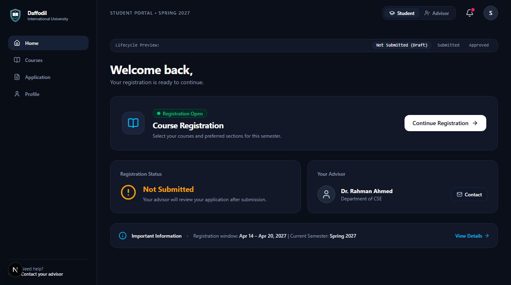
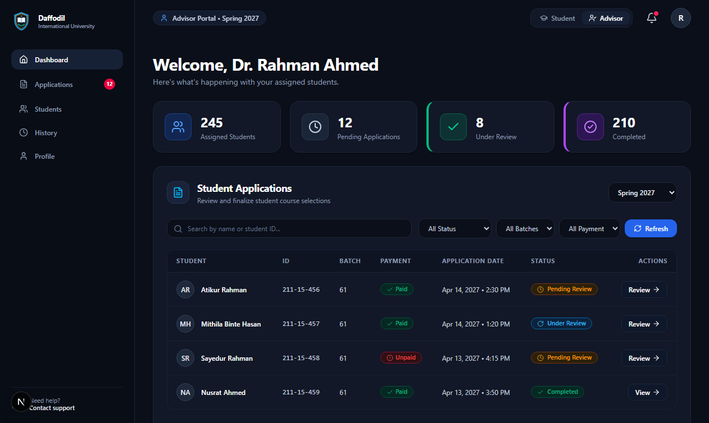

# Daffodil International University (DIU) — Course Registration Platform

> An institutional, production-grade course registration platform designed and engineered for Daffodil International University (DIU). Built with Next.js 16 (App Router), TypeScript (Strict), Tailwind CSS v4, and Supabase PostgreSQL with Row-Level Security (RLS).

---

## 📸 Visual Previews

### Student Portal Dashboard


### Advisor Portal Dashboard


---

## ⚡ Core Architecture & Features

- **Institutional Design System**: Bespoke dark aesthetic (`#0b0f19` canvas, `#121827` elevated cards, `#1c263c` borders, `#172136` active nav pill) with authentic DIU emblem crest and topographic contour curves.
- **Unified Courses Registration Workspace (`/courses`)**: Single-screen course selection with 150ms debounced search, level filtering, regular vs. retake/backlog categorization, live section seat counters, and persistent registration cart summary with review-and-submit workflow.
- **Academic Advising Queue & Review Studio (`/advisor`)**:
  - Live KPI stats: Assigned Students, Pending Applications, Under Review, Completed.
  - Multi-parameter filter ribbon (Search, Status, Batch, Payment clearance).
  - One-by-one advisee review studio with in-place section reassignment and atomic approval/revision determination.
- **Strict Role-Based Access Control**:
  - `student`: Profile, Course Selection, Timetable, Application Tracking, Academic Transcript.
  - `advisor`: Advisee Queue, Roster, Application Audit, Determination.
  - `department_head` & `admin`: Capacity overrides, semester scheduling, departmental roster oversight.
- **Zero Academic Fabrication**: Standard DIU 4.00 grading scale, department codes (CSE, SWE, EEE, BBA, ENG), authentic course codes, and prerequisite verification.

---

## 🛠️ Technology Stack

| Layer | Technology |
| :--- | :--- |
| **Framework** | Next.js 16 (App Router with Turbopack) |
| **Language** | TypeScript 5 (Strict Mode) |
| **Styling** | Tailwind CSS v4 + Lucide Icons |
| **Database** | PostgreSQL via Supabase (Strict RLS Policies) |
| **Validation** | Zod Schemas |
| **Email** | Resend API Integration with fallback logger |

---

## 🚀 Getting Started

### 1. Clone & Install Dependencies
```bash
git clone https://github.com/siaym/courseregdiu.git
cd courseregdiu
npm install
```

### 2. Environment Configuration
Copy the template and provide your Supabase and Resend credentials:
```bash
cp .env.example .env.local
```

### 3. Run Development Server
```bash
npm run dev
```

Visit [http://localhost:3000](http://localhost:3000) to access the application.

### 4. Build & Typecheck
```bash
npm run lint
npm run build
```

---

## 📚 Project Documentation

- [`AGENTS.md`](./AGENTS.md) — Multi-Agent Engineering Playbook & Operational Rules
- [`DESIGN_SYSTEM.md`](./DESIGN_SYSTEM.md) — Institutional Brand Tokens & UI Specifications
- [`SYSTEM_ARCHITECTURE.md`](./SYSTEM_ARCHITECTURE.md) — App Router, SSR, Middleware & Auth Pipelines
- [`DATABASE_SCHEMA.md`](./DATABASE_SCHEMA.md) — PostgreSQL Schemas, Foreign Keys & RLS Security Policies
- [`IMPLEMENTATION_STATUS.md`](./IMPLEMENTATION_STATUS.md) — Feature Progress Matrix & Verification Logs
- [`HANDOFF.md`](./HANDOFF.md) — Sprint Handover & Architecture Decisions

---

© Daffodil International University. Engineered for academic excellence.
