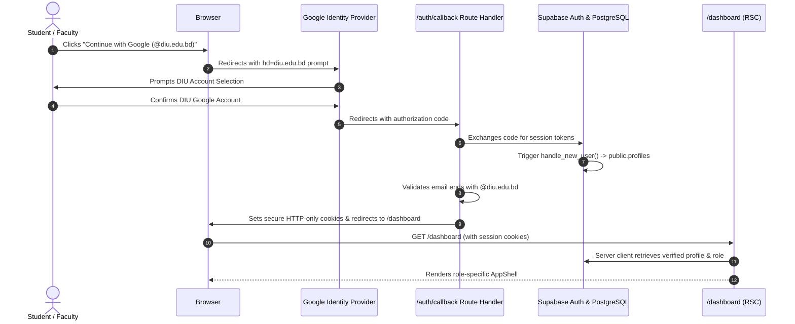

# SYSTEM ARCHITECTURE — DIU Course Registration Platform

> **Document Version**: 1.0.0 (Phase 0 Foundation)  
> **Target Framework**: Next.js 16 (App Router) + React 19 + TypeScript 5  
> **Database & Auth**: PostgreSQL 15+ (Supabase) + Supabase SSR + RLS  
> **Email Subsystem**: Resend Transactional Engine  

---

## 1. High-Level Architecture Topology

```mermaid
flowchart TD
    subgraph Client["Client Tier (Browser)"]
        Browser["User Browser (Desktop/Mobile)"]
        GoogleSSO["Google Accounts SSO (@diu.edu.bd)"]
    end

    subgraph Edge["Edge / Network Tier"]
        Proxy["Next.js Middleware / Proxy<br/>(Session Refresh & Domain Check)"]
    end

    subgraph App["Next.js 16 App Router (Server Tier)"]
        RSC["React Server Components<br/>(Dashboard, Shell, Pages)"]
        SA["Server Actions / Route Handlers<br/>(Zod Validated Mutations)"]
        AuthGuards["Role Guards<br/>(requireAuth, requireRole)"]
    end

    subgraph Data["Data & Security Tier (Supabase)"]
        AuthServer["Supabase Auth Engine"]
        Postgres["PostgreSQL Database"]
        RLS["Row Level Security (RLS) Layer"]
    end

    subgraph External["External Services Tier"]
        Resend["Resend Email API"]
    end

    Browser -->|HTTP Requests| Proxy
    Browser <-->|OAuth Redirection| GoogleSSO
    GoogleSSO -->|Callback Code| SA
    Proxy --> RSC
    Proxy --> SA
    RSC --> AuthGuards
    SA --> AuthGuards
    AuthGuards -->|@supabase/ssr| Postgres
    Postgres --- RLS
    SA -->|Trigger Notification| Resend
    Resend -->|Notification Email| Browser
```

---

## 2. Next.js 16 App Router Strategy

### 2.1 Server Components vs. Client Components Boundary
- **Server Components by Default**:
  - All page entries (`src/app/page.tsx`, `src/app/dashboard/page.tsx`, `src/app/login/page.tsx`) are React Server Components (RSC).
  - Data fetching (user profile, active semester, department catalog) executes on the server alongside cookie-based session verification.
  - Eliminates client-side waterfalls and protects backend logic from exposure.
- **Client Components (`"use client"`)**:
  - Reserved strictly for interactive UI boundaries:
    - `src/components/auth/google-sign-in-button.tsx` (OAuth trigger)
    - `src/components/shell/header.tsx` & `src/components/shell/sidebar.tsx` (Mobile collapse states)
    - `src/components/shell/user-menu.tsx` (Sign out action)
    - Forms with React Hook Form & client-side feedback.

---

## 3. Authentication & Authorization Flow



### 3.1 Multi-Email Identity & Domain Enforcement Mechanism
The authentication layer implements the DIU Final Authentication Policy:
1. **Student Authentication**:
   - Default eligibility requires a verified Google account ending in `@diu.edu.bd`.
   - Personal emails (e.g., `@gmail.com`) are rejected by default unless explicitly authorized by an Administrator in `public.authorized_emails`.
   - Admin-authorized personal emails resolve to the student's *existing* canonical profile via `resolve_profile_by_email` / `resolveEmailAuthorization`.
   - Zero duplicate profile creation: primary DIU email and authorized personal email map to the same `profile_id`.
   - In Supabase Auth, secondary Google accounts link `authorized_emails.auth_user_id` to the existing profile without inserting duplicate `public.profiles`.
   - Canonical resolver `public.get_current_profile_id()` ensures all RLS policies operate on the student's canonical profile.
   - Removing an alternative email terminates its login authorization immediately on subsequent requests.
2. **Advisor Authentication**:
   - Faculty can use DIU or personal Google email, but the account must be explicitly pre-authorized by an Administrator in `public.authorized_emails`.
   - Active status is checked on every protected request. Deactivation immediately revokes advisor access.
3. **Admin Authentication**:
   - Administrator accounts must be manually provisioned in the database.
   - DIU or personal Google email is permitted, but domain alone never grants administrative privileges.
4. **Middleware Enforcement (`src/lib/supabase/middleware.ts`)**:
   - Verifies session tokens on edge requests.
   - Queries `authorized_emails` to authorize approved personal Google accounts while intercepting deactivated accounts or unauthorized personal emails with immediate sign-out.
5. **OAuth Callback Enforcement (`src/app/auth/callback/route.ts`)**:
   - Code exchange completes through Google OAuth.
   - Evaluates `resolveEmailAuthorization(email)`. Unauthorized personal accounts or deactivated accounts are purged via `supabase.auth.signOut()` and redirected to `/login?error=unauthorized_email` or `/login?error=email_revoked`.

### 3.2 Open Redirect Mitigation (`validateSafeRedirect`)
To defend against phishing and open redirection vulnerabilities in the OAuth callback lifecycle:
1. All `returnTo` parameters pass through `validateSafeRedirect()`.
2. Targets starting with `//`, containing backslashes (`\`), or specifying external protocols (`http:`, `https:`) are rejected.
3. Destination paths must match an explicit whitelist of internal application prefixes: `/dashboard`, `/courses`, `/student`, `/advisor`, `/schedule`, `/onboarding`, or `/admin`.
4. Invalid destinations cleanly fallback to `/dashboard`.

### 3.3 Server-Side Authorization & Onboarding Guards
Route access is shielded at the React Server Component layer before any UI rendering occurs:
- `requireAuth()`: Verifies authenticated Supabase session or issues HTTP 307 redirect to `/login`.
- `requireRole(allowedRoles)`: Verifies role membership or redirects to `/unauthorized`.
- `requireAdvisor()`: Enforces `advisor`, `department_head`, or `admin` role.
- `requireOnboarded()`: Checks `profiles.onboarding_completed`. Incomplete profiles are redirected to `/onboarding`.

---

## 4. Supabase Client Architecture

To ensure strict separation of concerns, three distinct Supabase client factory functions are provided:

1. **Browser Client (`src/lib/supabase/client.ts`)**:
   - Initialized via `createBrowserClient<Database>` from `@supabase/ssr`.
   - Used only in client components for client-side OAuth triggers and real-time subscriptions.
2. **Server Client (`src/lib/supabase/server.ts`)**:
   - Initialized via `createServerClient<Database>` from `@supabase/ssr`.
   - Reads and writes HTTP cookies asynchronously via Next.js `cookies()`.
   - Used across Server Components, Server Actions, and Route Handlers.
   - Enforces PostgreSQL RLS under the authenticated user's JWT.
3. **Admin Client (`src/lib/supabase/admin.ts`)**:
   - Initialized via `createClient<Database>` with `SUPABASE_SERVICE_ROLE_KEY`.
   - Bypasses RLS. Strictly forbidden in client or user-facing mutation paths.
   - Reserved exclusively for seed scripts, background reconciliation tasks, and internal audits.

---

## 5. Security & Row-Level Security (RLS) Model

| Table | SELECT Policy | INSERT Policy | UPDATE Policy | DELETE Policy |
| :--- | :--- | :--- | :--- | :--- |
| `profiles` | Own profile OR advisor/admin role | Trigger only (`handle_new_user`) | Own profile (name, phone) | Disallowed |
| `departments` | All authenticated users | Admin only | Admin only | Disallowed |
| `semesters` | All authenticated users | Admin only | Admin only | Disallowed |
| `courses` | All authenticated users | Admin only | Admin only | Disallowed |
| `sections` | All authenticated users | Admin only | Admin only | Disallowed |
| `registrations` | Own student ID OR assigned advisor/admin | Own student ID (status='draft') | Own draft OR advisor under review | Disallowed |
| `registration_items` | Own registration OR advisor/admin | Own draft registration | Own draft registration | Own draft registration |
| `audit_logs` | Admin only | All authenticated actions | Immutable (Disallowed) | Immutable (Disallowed) |

---

## 6. Transactional Email System (Resend)

- Located in `src/lib/email/resend.ts`.
- Factory pattern automatically checks if `RESEND_API_KEY` is active.
- **Development/Test Fallback**: If unconfigured or containing placeholder credentials, calls do not crash or block. Instead, a structured mock dispatch log is emitted to the system console.
- **Email Triggers**:
  - Registration submission receipt sent to student.
  - Review notification dispatched to assigned faculty advisor.
  - Decision broadcast (approval or required corrections) sent back to student.

---

## 7. Form & Validation Pipeline

- Built on **Zod 4** and **React Hook Form**.
- Centralized validation schemas located in `src/lib/validations/`:
  - `auth.ts`: DIU student ID format (`^\d{3}-\d{2}-\d{4,5}$`), DIU email regex (`@diu.edu.bd`), profile update limits.
  - `registration.ts`: Registration draft section limits (1 to 8 sections max), advisor review actions.
- Client components execute instant UI validation, while Server Actions re-validate every payload against the identical Zod schema before database commits.
