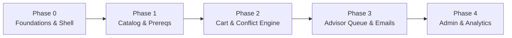

# DIU Course Registration Platform — Project Master Blueprint

> **Status**: Phase 0 Complete | Production Foundations Established  
> **Institution**: Daffodil International University (DIU), Dhaka, Bangladesh  
> **Maintainer**: Founding Architecture & Engineering Team  
> **Last Updated**: November 2026  

---

## 1. Executive Summary

The **DIU Course Registration Platform** is a modern, high-concurrency, security-hardened academic advising and course enrollment web application engineered specifically for Daffodil International University. 

The platform replaces legacy manual paper advising slips and overloaded legacy portal sessions with an event-driven, responsive portal featuring:
- **Instant Google Single Sign-On (SSO)** restricted strictly to `@diu.edu.bd` institutional accounts.
- **Real-Time Section Capacity & Schedule Conflict Resolution** preventing overlapping class slots and overbooked sections.
- **Automated Academic Policy Enforcement** verifying prerequisite completions, credit caps based on CGPA, and probation limits.
- **Two-Tier Advising Workflow** facilitating collaborative course selection between students and assigned faculty advisors.
- **Enterprise Row-Level Security (RLS)** isolating student data, ensuring advisors only review their assigned departmental cohort, and maintaining a tamper-evident audit log.

---

## 2. Institutional Academic Framework (DIU)

### 2.1 Academic Calendar & Semesters
DIU follows a tri-semester (or bi-semester for select specialized programs) academic structure:
- **Spring Semester**: Classes commence January/February.
- **Summer Semester**: Classes commence May/June.
- **Fall Semester**: Classes commence September/October.

*Rule of Truth*: Registration windows are opened selectively per student batch/credit level (e.g. graduating seniors first, followed by senior, junior, and freshman cohorts) to manage scheduling load.

### 2.2 Degree & Credit Model
- **Typical Undergraduate Degree**: ~140 to 152 credits depending on program (e.g. B.Sc. in CSE requires ~148 credits).
- **Normal Semester Load**: 12 to 18 credit hours.
- **Probationary Load**: Students on academic probation (CGPA < 2.00) are capped at 9 to 12 credit hours.
- **Graduating Senior Exception**: May request an overload up to 21 credits with Department Head approval.

### 2.3 Grading System (Official DIU Scale)
| Grade | Grade Point | Numerical Equivalent |
| :--- | :--- | :--- |
| **A+** | 4.00 | 80% and above |
| **A** | 3.75 | 75% to < 80% |
| **A-** | 3.50 | 70% to < 75% |
| **B+** | 3.25 | 65% to < 70% |
| **B** | 3.00 | 60% to < 65% |
| **B-** | 2.75 | 55% to < 60% |
| **C+** | 2.50 | 50% to < 55% |
| **C** | 2.25 | 45% to < 50% |
| **D** | 2.00 | 40% to < 45% |
| **F** | 0.00 | Less than 40% (Fail) |
| **I** | — | Incomplete |
| **W** | — | Official Withdrawal |

*Important Policy Notice*: All prerequisite checks require a passing grade (minimum `D` / 2.00). Courses marked `F` or `W` must be retaken.

---

## 3. User Personas & Access Boundaries

1. **Student**
   - Identifier: DIU Student ID (e.g. `211-15-12345`) + `@diu.edu.bd` email.
   - Capabilities: View eligible courses based on completed prerequisites, add sections to advising cart, review weekly schedule collision matrix, submit advising draft, track advisor approval status.

2. **Faculty Academic Advisor**
   - Identifier: Employee ID + `@diu.edu.bd` faculty email.
   - Capabilities: View list of assigned student advisees, inspect student academic transcript and CGPA, review proposed course sections, add mandatory advising remarks, approve or request revisions.

3. **Department Head / Program Coordinator**
   - Capabilities: Manage section allocations, assign instructors to sections, grant prerequisite waivers or credit overload exceptions, inspect department enrollment metrics.

4. **System Administrator / Registrar**
   - Capabilities: Manage global semester dates, initiate registration waves, manage departments and curriculum master definitions, inspect tamper-proof audit trails.

---

## 4. Multi-Phase Engineering Roadmap

### Phase 0: Foundations & Shell Architecture (COMPLETED)
- Next.js 16 App Router + Strict TypeScript + Tailwind CSS v4 + shadcn/ui tokens.
- PostgreSQL database schemas on Supabase with initial migrations and Row-Level Security (RLS).
- Google OAuth Single Sign-On restricted to `@diu.edu.bd` institutional emails.
- Server-side authorization helpers (`requireAuth`, `requireRole`, `getCurrentProfile`).
- Session refresh proxy/middleware with edge route protection.
- Resend transactional email foundation with mock fallback.
- Standard application shell: Header, collapsible sidebar, responsive layout, user profile badge.
- Comprehensive multi-agent architecture and governance documentation.

### Phase 1: Course Catalog & Prerequisite Validation Engine (NEXT SPRINT)
- Real DIU department curriculum seed tables (CSE, SWE, EEE, BBA, ENG).
- Prerequisite validation logic: Directed Acyclic Graph (DAG) evaluator checking completed course history.
- Course catalog browser with instant search, filter by department, semester level, and credit count.
- Course detail modals displaying syllabus links, lab requirements, and course outcomes.

### Phase 2: Student Registration Cart & Schedule Conflict Resolver
- Interactive weekly schedule grid (Saturday to Thursday, 08:30 to 17:30).
- Real-time time slot collision algorithm (detecting overlapping classes and exam slot conflicts).
- Section selection cart with live capacity counter and waitlist queue.
- Credit load limit validator based on student CGPA and standing.
- Registration submission pipeline creating formal `pending_advisor` requests.

### Phase 3: Academic Advisor Review & Transactional Notifications
- Advisor dashboard displaying assigned student queue sorted by submission timestamp and risk level.
- Side-by-side comparison of student transcript, prerequisite compliance, and requested sections.
- Action modal for one-click approval or rejection with structured faculty remarks.
- Resend email trigger: Instant notification dispatched to student upon review completion.

### Phase 4: Timetabling Administration & Institutional Analytics
- Section scheduling manager for department coordinators (room allocation, instructor assignment).
- Capacity alerts for over-subscribed and under-enrolled sections.
- Departmental registration velocity analytics and enrollment heatmaps.
- Complete CSV/Excel roster export for DIU ERP compatibility.

---

## 5. Security & Compliance Mandates

1. **Authentication Policy**: Only `@diu.edu.bd` institutional Google accounts can authenticate. Passwords are not accepted or stored.
2. **Data Privacy**: Student CGPA, transcript records, and advisor remarks are strictly private under FERPA-grade institutional privacy policies, enforced via PostgreSQL RLS.
3. **Audit Trail**: Every registration status change, section drop, or advisor waiver is logged into `public.audit_logs` with actor ID, timestamp, and client metadata.
